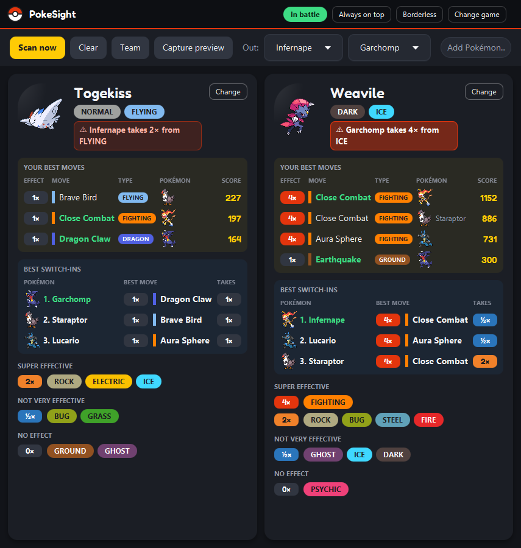

# PokeSight

> **About this project and AI:** PokeSight was coded entirely by an AI coding assistant (Claude Code); I directed it,
> tested the app and decided what to build. I did this on purpose, to see how a fully AI-coded app compares with an
> app I develop myself from scratch. **Result:** for a simple app like this it works surprisingly well, and it was
> surprisingly fast.

PokeSight is a second-screen companion for Pokémon games. It reads the opponents' names from the screen, detects
when a battle starts and shows each opponent's weaknesses, resistances and immunities, which moves of your team hit it
hardest and which of your Pokémon takes its attacks best. It only looks at the screen, so it needs no emulator plugin
or memory access.

| Single battle | Double battle |
|---|---|
|  |  |

- Single, double and triple battles and hordes, auto-detection plus **Scan now** if a battle was missed
- Correct a misread Pokémon or add one by hand with a name search
- **Your best moves**: enter your team once (or let PokeSight read the moves from the game), see the strongest move
  per opponent, ranked by power, type, STAB and the Pokémon's base stats; moves are marked with their type colour.
  When you pick moves, each Pokémon shows whether physical or special moves suit it (Attack vs Sp. Atk), and moves of
  that kind are suggested first
- **Who is out**: with your own name boxes selected (or picked by hand), your active Pokémon's moves are marked and the
  card says whether another team member hits harder; in double battles both of your Pokémon on the field
- **Safest switch-ins**: which of your Pokémon takes the opponent's attacks of its own types best
- **Worth catching**: a ★ next to the name marks Pokémon worth catching for your team; hover it to see why
  (see [Catch star](#catch-star))
- **Terastallization** (Scarlet/Violet): set an opponent's Tera type on its card
- **Borderless mode**: only the cards, filling a small window you can put over a part of the emulator
- Regional forms: in Sun/Moon a wild Meowth is shown as Alolan Meowth, in Sword/Shield as Galarian Meowth, etc.
- Dark theme, original sprites, English and German game names

**Supported:** all main-series games from Red/Blue to Legends: Z-A, English and German, on Windows. Every game uses
the rules of its own generation (type chart, types, move power); remakes are separate games with their own rules and
screens, e.g. Red/Blue (Gen 1, Game Boy font) and FireRed/LeafGreen (Gen 3, GBA font).

**ROM hacks:** see [Supported ROM hacks](#supported-rom-hacks).

The name reading is checked on 254 real battle screenshots, at least five per game, at emulator window sizes 1×, 2×
(smoothed) and 3× (Full HD screenshots of the Switch games at their size). Correctly read views:

| Game | Ruleset | Read | | Game | Ruleset | Read |
|---|---|---|---|---|---|---|
| Red / Blue | gen1 | 36 / 42 | | Black / White | gen5 | 37 / 54 |
| Yellow | gen1 | 32 / 33 | | Black 2 / White 2 | gen5 | 30 / 45 |
| Gold / Silver | gen2 | 28 / 33 | | X / Y | gen6 | 28 / 48 |
| Crystal | gen2 | 34 / 36 | | Omega Ruby / Alpha Sapphire | gen6 | 29 / 42 |
| Ruby / Sapphire | gen3 | 37 / 39 | | Sun / Moon | gen7 | 26 / 27 |
| Emerald | gen3 | 36 / 39 | | Ultra Sun / Ultra Moon | gen7 | 20 / 24 |
| FireRed / LeafGreen | gen3 | 26 / 27 | | Let's Go, Pikachu! / Eevee! | lets-go | 7 / 8 |
| Diamond / Pearl | gen4 | 38 / 39 | | Sword / Shield | gen8 | 10 / 10 |
| Platinum | gen4 | 42 / 42 | | Brilliant Diamond / Shining Pearl | gen8 | 6 / 6 |
| HeartGold / SoulSilver | gen4 | 33 / 33 | | Legends: Arceus | gen8 | 9 / 9 |
| | | | | Scarlet / Violet | gen9 | 14 / 15 |
| | | | | Legends: Z-A | gen9 | 5 / 5 |

That is 563 of 656 views (86 %) on the very first scan. PokeSight also learns the letter shapes of your game while
you play (see [How it works](#how-it-works)); learned from the other screenshots of the same game, it reads 582 of 656
views (89 %), most of all in the Game Boy games (Red/Blue 41 / 42, Crystal 36 / 36) and Ultra Sun / Ultra Moon
(23 / 24). A missed view is usually a single scan: PokeSight scans every 0.7 s and a battle starts as soon as two of
the last three scans agree, so it is still detected as long as most scans read the name. The Game Boy, GBA and DS
games work best. In Black/White and X/Y the narrow, outlined fonts are read less reliably. In Legends: Arceus, Scarlet/Violet and Legends: Z-A the name floats above the opponent in the 3D
scene and is found by its HP bar, also when the bar is almost empty; only a fainted opponent's empty bar is not found.
Text of the scene is only taken for a name if it stands right over the bar. If a game works badly for you, a
screenshot of your emulator window during a battle helps to improve it.

> PokeSight is a fan project. It is not affiliated with, endorsed or sponsored by Nintendo, Game Freak, Creatures or
> The Pokémon Company. Pokémon and all related names are trademarks of their respective owners.

## Supported ROM hacks

Listed below the official games with a "ROM hack" badge. Rules come from each hack's own data; English only.

**[Pokémon Heartfelt Gold](https://pokehackdex.com/romhacks/pokemon-heartfelt-gold/)** (HeartGold, hg-engine):
Pokémon of all generations, Gen 9 types and type chart, the hack's move changes and in-game names, the game's own
sprites. Names read: 6 / 6.

**[Pokémon Odyssey](https://eeveeexpo.com/odyssey/)** (FireRed): its own Aether type instead of Fairy, Etrian
Variants, new Pokémon (no sprite) and new or changed moves, from the developer's data. Names read: 8 / 9.

**[Pokémon R.O.W.E.](https://www.hackdex.app/hack/pokemon-rowe)** (Emerald, pokeemerald): open-world Emerald with all
1025 Pokémon and Fairy; the hack's changed types (e.g. Poison/Dark Arbok), stats and moves, in-game names
and its own sprites, from its source code (default game options). Names read: 7 / 9.

**[Pokémon Unbound](https://pokefirered.com/pokemon-unbound/)** (FireRed, CFRU + DPE): Pokémon up to Gen 8 and Fairy;
the hack's changed stats and move powers, its own moves, in-game names and GBA-style sprites, from Skeli's
public source code. Names read: 12 / 12.

**[Pokémon Glazed](https://www.gamebrew.org/wiki/Pokemon_Glazed_GBA)** (Emerald, v9.1): Gen 1-6 Pokémon in Emerald's
411 slots, Fairy, Gen VII stats and moves, Mega Evolutions as own slots. No source code exists: built from the
changelog, the fan wiki's slot table and the developers' move document; sprites are the official ones. Names read: 14 / 15.

**[Pokémon Emerald Rogue](https://www.hackdex.app/hack/emerald-rogue)** (Emerald, pokeemerald-expansion, EX edition
v2.1): roguelite Emerald with all 1025 Pokémon; types, stats and moves are the expansion's defaults (Gen 9),
names as in the game (10 letters, "Kilowatrel") and its own sprites, from its source code. The Vanilla edition keeps
Emerald's data unchanged: choose Pokémon Emerald for it. Names read: 8 / 12.

**[Pokémon Lazarus](https://pokemonlazarus.net/)** (Emerald, pokeemerald-expansion, v2.0): the Ilios region with
GBC-style graphics. No source code exists; the developer's documentation and the changelogs change no matchup outside
Mega Evolutions (which PokeSight leaves out), so the rules are the expansion's Gen 9 defaults; sprites are the official
ones. Names read: 3 / 10 (the only battle screenshots are a 1.5x scaled collage).

## Custom games

Fan games that are not ROM hacks, listed below them with a "Custom" badge. English only.

**[Pokémon Platinum Together](https://platinumtogether.online/)** (multiplayer mod of Platinum with its own launcher):
the start screen has one switch for the world rule that changes matchups, **MODERN POKéMON** (off by default, as in a
new world). PokeSight remembers it in `settings.yaml`, like the window position.

| MODERN POKéMON | What PokeSight uses |
|---|---|
| OFF | Platinum's own 493 Pokémon, types, moves and type chart |
| PREVIEW (switch on) | also the Pokémon of the newer games (Gen 5-9), the Fairy type and the Gen 6+ type chart (Clefairy is Fairy, Steel no longer resists Ghost or Dark), the newer games' types and moves (Ralts is Psychic/Fairy, Knock Off 65), Fairy moves |

The other rules (MORE POKéMON, RANDOM POKéMON, LEVEL CAPS, SPEED UP, ...) change no type. Base stats stay Platinum's
for the original 493 Pokémon (no [patch note](https://platinumtogether.online/patch-notes/) changes them). MODERN
BATTLES only changes the battle screen and status rules, not types: both screens are read like Platinum's (all-caps
names). Sprites are the default PokeAPI ones (the mod's animated sprites are not published).

## Getting started

### Option 1: Download a release (no Java needed)

1. Download `PokeSight-<version>-windows.zip` from the [Releases](../../releases) page.
2. Unzip it anywhere and start `PokeSight\PokeSight.exe`.

The first battle view downloads the sprites of the selected game (0.5–2 MB) from
[PokeAPI/sprites](https://github.com/PokeAPI/sprites); until then, or offline, the cards show no sprite.

### Option 2: Run from source

Requirements: Windows and a JDK 25 (for example `winget install EclipseAdoptium.Temurin.25.JDK`). Clone the repository
to a Windows folder (not inside WSL: the app captures the Windows desktop), then:

```
gradlew.bat run
```

or run the Gradle task `run` (group *application*).

The first build downloads the OCR models and the test screenshots (see [Licenses](#licenses-and-credits)).

### Option 3: Build your own exe

| Gradle task (group *distribution*) | Result |
|---|---|
| `gradlew.bat installLocal` | Installs for the current user to `%LOCALAPPDATA%\Programs\PokeSight` with desktop and Start menu shortcuts |
| `gradlew.bat portableZip` | `build/distributions/PokeSight-<version>-windows.zip`: unzip anywhere and start `PokeSight.exe` |
| `gradlew.bat jpackageImage` | Just the app folder `build/jpackage/PokeSight` (`PokeSight.exe` + Java runtime) |

## Using PokeSight

1. Start the game in your emulator and PokeSight next to it (a second monitor works best).
2. On the start screen pick the game and its language (and, for Platinum Together, whether MODERN POKéMON is on).
3. Optionally select the **screen areas** where the opponents' name boxes appear:

   | Setting | What to select |
   |---|---|
   | Single battle area | the opponent's name box in a single battle |
   | Double battle area | the part with both opponents' name boxes in a double battle |
   | Your single battle area | your own Pokémon's name box in a single battle: tells PokeSight which of your team is out |
   | Your double battle area | the part with both of your own Pokémon's name boxes in a double battle: both of them are out |

   Each scan reads every selected opponent area and uses the one that recognizes the most names; your own areas the
   same way. Without any opponent
   area the whole main screen is read: slower, and it may pick up other windows. PokeSight reads what is visible on screen, including
   its own window, so never let it cover a selected area. With melonDS's hybrid layout, select the name boxes on the
   large screen; PokeSight can cover the small copy of the top screen.
4. Press **Start**. Use **Capture preview** to check what the scan sees.

| Control | Purpose |
|---|---|
| automatic | A battle starts when the same names are read in two of the last three scans (every 0.7 s); it ends after about 4 s without any name |
| **Scan now** | Reads the screen immediately, even if auto-detection did not trigger |
| **Team** | Your team: up to six Pokémon with up to four moves each; **Read** fills a Pokémon's moves from the game (see below) |
| **Change** (on a card) | Search for the correct Pokémon if a name was misread; also for alternate forms like Sandy Wormadam |
| **Tera…** (on a card, Scarlet/Violet) | It terastallized: pick its Tera type. It then has that type alone, but still attacks with its own types too |
| **Out:** | Which of your team is on the field; read from your own name boxes if those areas are selected, or picked here. A second choice appears with two opponents (double battle) |
| **Add Pokémon…** | Add an opponent by hand |
| **Clear** | Forget the current battle, corrections and additions |
| **Capture preview** | Shows (and saves) the last captured images |
| **Always on top** | Keeps the window above the emulator |
| **Borderless** | Only the cards remain and fill the window: one opponent the whole window, two opponents the left and right half. Hovering shows a button bar (scan, clear, team, always on top, exit); Esc also exits; drag to move |

In a double battle the two opponents stand side by side (left and right), in the normal view and in borderless mode;
more opponents (triple battles, hordes) continue in rows of two. The default window size is 855 × 640, which every
view fills; PokeSight remembers the size and position you leave it at.

**Reading your team:** in the team editor, press **Moves area…** once per game and drag a rectangle around the move
names of the game's move selection (the fight menu or the summary's move list). Optionally press **Name area…** and
drag a rectangle around the Pokémon's name on the same screen. Then open a Pokémon's move selection or summary in the
game and press **Read** in a row: the Pokémon is filled in from the name (another Pokémon than the row had replaces it,
with its moves), and the damaging moves found fill the empty move fields. Status moves are skipped, they do not take
part in the ranking. The move under the cursor is drawn highlighted and often not read: move the cursor and press
**Read** again, moves already in the row are kept. A nickname cannot be matched to a species: pick nicknamed Pokémon
by hand, Read still fills in their moves.

**Your best moves** ranks the team's moves per opponent by move power × type effectiveness × 1.5 if the move has its
Pokémon's type (STAB) × your Pokémon's base Attack / the opponent's base Defense (Sp. Atk / Sp. Def for special
moves; until Gen 3 the move's type decides). Level, natures, EVs and stat changes are not known: the score ranks the
moves, it is not the exact damage. With your active Pokémon known, its best move is always listed and marked, and a
line above says either "Infernape is out: Close Combat is your best move." (green) or which team member hits harder
(yellow), so you can decide whether to switch.

**Safest switch-ins** lists the team members that take the opponent's attacks of its own types (its STAB moves, the
most likely threats) best, with the multiplier per type. The opponent's real moves are not known.

### Catch star

A ★ next to an opponent's name means it is worth catching. Earlier stages get the star of their evolution: Magikarp
gets Gyarados's, Abra gets Alakazam's. A list entry for one evolution path only stars that path: "Eevee (Vaporeon)"
stars Eevee and Vaporeon, not Flareon.

| Rule | Which Pokémon |
|---|---|
| Always | Legendary and mythical Pokémon, Ultra Beasts, Paradox Pokémon |
| Games with a Smogon in-game tier list | The top tiers (S and A; High in the older lists). These lists rate each line for a playthrough by availability, typing, stats, movepool and the major battles |
| Games without a list, and Pokémon newer than the list's game (Platinum Together's MODERN POKéMON) | The 5 strongest final evolutions of each type by base stat total, ties included. Dual types count for both types; the groups that are always starred are left out |

| Tier list | Games |
|---|---|
| [Smogon guides](https://www.smogon.com/ingame/guides/): Red/Blue/Yellow, Ruby/Sapphire/Emerald, FireRed/LeafGreen, Diamond/Pearl, Platinum, HeartGold/SoulSilver, Black/White | those games, and Platinum Together (Platinum's list) |
| Smogon forum lists (S and A tiers transcribed): Gold/Silver/Crystal, Black 2/White 2, Omega Ruby/Alpha Sapphire, Sun/Moon, Ultra Sun/Ultra Moon, Brilliant Diamond/Shining Pearl | those games |
| none (base stats) | X/Y (its forum list rates only 12 Pokémon), Let's Go, Sword/Shield, Legends: Arceus, Scarlet/Violet, Legends: Z-A, all ROM hacks |

Version-exclusive entries only count in their version (Squirtle is A in Red/Blue, B in Yellow). Pokémon that a list
leaves out (unavailable before the end of the game, such as Bagon in HeartGold/SoulSilver) get no star. ROM hacks'
own Pokémon (Glazed's Mega slots, event battle Pokémon) get none either. Shiny Pokémon cannot be recognized:
PokeSight only reads the name.

## Settings

All settings are plain YAML files in `%APPDATA%\PokeSight`; nothing is written to the registry. Edit them only while
PokeSight is closed; a file that cannot be read is ignored and the defaults are used. Delete the folder to reset.
The sprites are a download cache in `%LOCALAPPDATA%\PokeSight\sprites`; they are downloaded again if deleted. The
letter shapes learned per game are in `%LOCALAPPDATA%\PokeSight\glyphs\<game id>.txt` (saved every minute while
scanning); **Forget learned letters** on the start screen deletes the selected game's file, for example after changing
the emulator's window size or screen filter a lot.

On start PokeSight asks GitHub once whether a newer version exists (one anonymous request, nothing about you is sent)
and shows a **Download** button on the start screen if so. Set `updateCheck: false` in `settings.yaml` to turn this
off.

```
%APPDATA%\PokeSight\
├─ settings.yaml          last game and language, window position, size and maximized state, updateCheck,
│                          game switches (gameOptions: Platinum Together's MODERN POKéMON)
└─ games\
   └─ <game id>.yaml      screen areas (singleArea, doubleArea, ownArea, movesArea, nameArea) and your team for that game
```

```yaml
# games/<game id>.yaml, e.g. games/red-blue.yaml
singleArea: { x: 2, "y": 210, width: 757, height: 211 }   # screen pixels; null = not selected
doubleArea: { x: 1, "y": 104, width: 1099, height: 418 }
ownArea: { x: 520, "y": 330, width: 400, height: 90 }    # your own name box: which of your team is out
ownDoubleArea: { x: 500, "y": 300, width: 600, height: 180 } # both of your name boxes in a double battle
movesArea: { x: 40, "y": 520, width: 600, height: 160 }   # the move selection, read by the team editor
nameArea: { x: 40, "y": 80, width: 260, height: 50 }     # the Pokémon's name next to its moves (team editor)
team:
  - { pokemon: 4, form: 0, moves: [52, 10] }              # national dex number, form index, move ids
```

## How it works

Every 0.7 seconds PokeSight takes a screenshot of the selected areas and reads them with [Tesseract](https://github.com/tesseract-ocr/tesseract) OCR.
Game fonts are tiny pixel fonts with a drop shadow or an outline, so each image is prepared first: only the pixels
close to the text colour are kept (some games use white text on dark boxes, others dark text on light ones, so both
are tried; white text must also be uncoloured, which drops sky and water behind the 3DS and Switch name boxes), box
borders and HP bars are removed, the remaining letter-sized shapes are kept and scaled to about twice the DS size.
The text is then matched against the game's Pokémon names with a small edit distance in which letters OCR often mixes
up (G/S, O/D/C, U/V/W, ...) count half; name boxes standing side by side on one line (double battles since Gen 5) are
split at wide gaps. In games that write names in capitals (Gen 1–4), text in mixed case (code, chats, websites) is
ignored. In the games whose names float in the 3D scene, the solid HP bars are located first and only the labels
above them are read.

Tesseract misreads some pixel fonts consistently (Black/White "Ramoth" as "kanoth"), although the prepared letters are
clean. So PokeSight learns the font of your game on your screen: whenever a word is a name (at most one look-alike
letter off), the shapes of its letters are stored under that name's letters, and every image is also read by
comparing its letter shapes with the stored ones. Both readings vote. The shapes come from your own emulator window and
stay on your computer; nothing of the games ships with PokeSight. The tests are listed under
[Development](#development).

## Development

```
src/main/java/de/alorbach/pokesight/
├─ PokeSightApp.java     entry point, wires everything together
├─ game/                 game definitions (games/*.yaml): ruleset, languages, sprite URL
├─ sprite/               sprite download and cache in %LOCALAPPDATA%\PokeSight\sprites
├─ ruleset/              generation data: types, type chart, species, forms, moves
├─ capture/              screenshots of screen regions
├─ ocr/                  Tesseract adapter, image preparation, learned letter shapes, HP bar search
├─ battle/               name matching, battle scanning, auto-detection, move reading
├─ matchup/              weaknesses, move ranking, switch-ins, attack style
├─ catching/             catch star: Smogon tier lists, legendaries, strongest of each type
├─ settings/             settings files in %APPDATA%\PokeSight
├─ update/               update check against the GitHub releases
└─ ui/                   JavaFX views (start screen, battle view, cards, team editor, title bar, theme)

src/main/resources/      games/*.yaml, rulesets/<id>/*.yaml (generated), pokedex.yaml and tiers/*.yaml (generated,
                         catch star), ui/ (theme, font, icons)
packaging/               PokeSight.ico, install.ps1 (installLocal)
tools/                   GenerateRuleset.java (PokeAPI → YAML), GenerateHgEngineRuleset.java (hg-engine hack → YAML),
                         GenerateOdysseyRuleset.java (Odyssey workbook → YAML), GeneratePokeemeraldRuleset.java
                         (pokeemerald hack → YAML), GenerateCfruRuleset.java (CFRU + DPE hack → YAML),
                         GenerateGlazedRuleset.java (Glazed documentation → YAML), GenerateLazarusRuleset.java
                         (Lazarus: gen9 → YAML), GenerateCatchData.java (PokeAPI evolutions + Smogon tier
                         lists → YAML), GenerateIcon.java (app icon)
.github/workflows/       release.yml: builds the portable zip for every pushed v* tag
licenses/                license texts of the bundled third-party software (THIRD-PARTY-NOTICES.md)
```

| Pattern | Where | Why |
|---|---|---|
| Adapter | `TextRecognizer` / `TesseractTextRecognizer` | Swap the OCR engine without touching the battle logic |
| Adapter | `ScreenSource` / `RobotScreenSource` | Screenshots are faked in tests; another source can plug in later |
| Observer | `BattleMonitor` → `BattleView` | Background scanning pushes changes to the UI |
| View model | `BattleBoard` | Corrections and added Pokémon, testable without JavaFX |

- **Tests:** `gradlew.bat test` runs the fast tests (seconds); `gradlew.bat ocrTest` the OCR tests on the real
  screenshots (several minutes); `gradlew.bat check` both.
- **Release:** push an annotated tag such as `v1.0.0`; the workflow runs both test tasks, builds the portable zip and
  attaches it to a release titled with the tag message's first line.
- **Add a game:** create `games/<id>.yaml` (copy an existing game of the same generation) and list `<id>` in
  `games/index.yaml` (ROM hacks under `romHacks`, other fan games under `custom`; both are listed below the official
  games). `region` (alola, galar, hisui, paldea) makes recognized Pokémon show in their regional form,
  `floatingNames` reads the labels above HP bars instead of fixed name boxes, `terastal` offers the Tera type picker,
  `options` adds start-screen switches that take types (`typesFrom`) or added Pokémon (`speciesFrom`) from another
  ruleset (Platinum Together), `tierList` names the Smogon in-game tier list behind the catch star (`tiers/<id>.yaml`).
- **OCR tests:** `src/test/resources/screenshots.tsv` lists the battle screenshots (URL, SHA-256, game, language, the
  opponents they show and, for collages, where the game screen is); the build downloads them. `GameScreenshotOcrTest`
  reads every one with its game's settings and fails when a game reads fewer views than the minimum recorded there,
  once with Tesseract alone and once with letter shapes learned from the game's other screenshots (it needs all of
  them; CI skips it, since one wiki blocks downloads from there); `ScreenshotOcrTest` checks Gen 4 at every window
  size, `MoveReaderTest` the move reading. All of them are tagged `ocr` and run with `ocrTest`. ROM hacks have their
  own screenshots and minimums; the official games' minimums may only rise, so work on a hack can never make an
  official game read worse.
- **Regenerate a ruleset:** `java tools/GenerateRuleset.java <PokeAPI version group> src/main/resources/rulesets/<id>`.
  It writes the type chart, the species with their alternate forms and base stats and the damaging moves, as they
  were in that game (PokeAPI's change logs are rolled back, e.g. Thunderbolt has 95 power in Gen 4, Butterfree has
  Sp. Atk 80 until Gen 5, Gen 1 has one Special stat):

  | Ruleset | Version group | | Ruleset | Version group |
  |---|---|---|---|---|
  | gen1 | yellow | | gen6 | omega-ruby-alpha-sapphire |
  | gen2 | crystal | | gen7 | ultra-sun-ultra-moon |
  | gen3 | firered-leafgreen | | lets-go | lets-go-pikachu-lets-go-eevee |
  | gen4 | heartgold-soulsilver | | gen8 | legends-arceus |
  | gen5 | black-2-white-2 | | gen9 | the-indigo-disk |
- **Regenerate a ROM hack ruleset** (hacks built with [hg-engine](https://github.com/BluRosie/hg-engine)):
  `java tools/GenerateHgEngineRuleset.java <hack's HG-Engine folder> <hg-engine> src/main/resources/rulesets/gen9 src/main/resources/rulesets/<id>`,
  with pinned raw GitHub URLs or local folders (the exact command for Heartfelt Gold is in the tool's Javadoc). It reads
  the hack's `config.h`, `Species.c` and `Moves.c` and hg-engine's type chart and sprite
  folders (the game sets `spriteSheets: true`: the first of the two frames is kept, background transparent); the gen9
  ruleset only supplies dex numbers (checked against PokeAPI), form names, type names and move ids.
  Pokémon Odyssey: `java tools/GenerateOdysseyRuleset.java <workbook .xlsx or its export URL> src/main/resources/rulesets/gen9 src/main/resources/rulesets/odyssey`
  (URL in the tool's Javadoc). It reads the type chart from the cell colours, types and base stats of every
  species, the Pokédex slot names and the new moves (type and category icons recognized by their hash); the workbook's
  SHA-256 is written into the generated files, since the developer can update it.
  Hacks built on [pokeemerald](https://github.com/pret/pokeemerald) with the battle engine expansion (Pokémon R.O.W.E.,
  Emerald Rogue EX):
  `java tools/GeneratePokeemeraldRuleset.java <hack's source> <source with battle_util.c> src/main/resources/rulesets/gen9 src/main/resources/rulesets/<id>`
  (exact command in the tool's Javadoc). It evaluates the hack's `#if` settings (config headers) and reads
  `base_stats.h`, `battle_moves.h`, the in-game names and the front sprites (`spriteSheets: true`: the top frame is
  kept); moves PokeAPI does not know become the hack's own (key 20000 + its move id). Newer expansions (1.7+, with
  `species_info.h` and `include/config/`) are detected: their species entries, shared-field macros and conditional
  values (`P_UPDATED_TYPES >= GEN_6 ? TYPE_FAIRY : TYPE_NORMAL`) are evaluated like the C preprocessor does.
  Hacks built on [CFRU](https://github.com/Skeli789/Complete-Fire-Red-Upgrade) and
  [DPE](https://github.com/Skeli789/Dynamic-Pokemon-Expansion) (Pokémon Unbound):
  `java tools/GenerateCfruRuleset.java <DPE> <CFRU> src/main/resources/rulesets/gen9 src/main/resources/rulesets/<id> [DEFINE...]`
  (exact command in the tool's Javadoc; Unbound: `UNBOUND`). It evaluates CFRU's `config.h` plus the given defines and
  reads DPE's `Base_Stats.c`, name tables and front sprites and CFRU's type chart and `battle_moves.c`; Z-Moves and
  Max Moves are left out, the hack's own moves get key 20000 + its move id.
  Pokémon Glazed (binary hack, no source): `java tools/GenerateGlazedRuleset.java src/main/resources/rulesets/gen7 src/main/resources/rulesets/glazed`
  reads the fan wiki's slot table (pinned revision) and the move document and applies the changelog to the gen7
  ruleset (sources in the tool's Javadoc).
  Pokémon Lazarus (binary hack on pokeemerald-expansion): `java tools/GenerateLazarusRuleset.java src/main/resources/rulesets/gen9 src/main/resources/rulesets/lazarus`
  takes the expansion's default (Gen 9) data with English names only (why in the tool's Javadoc).
- **Regenerate the catch star data:** `java tools/GenerateCatchData.java src/main/resources` writes
  `pokedex.yaml` (evolutions and legendary/mythical flags from PokeAPI; Ultra Beasts and Paradox Pokémon after
  Bulbapedia) and `tiers/<id>.yaml`. The Smogon guides are downloaded and parsed; the forum lists cannot be read by
  scripts, so their S and A tiers are transcribed in the tool. Every entry is checked against PokeAPI: an unknown name
  or an evolution path that does not exist stops the run.
- **Data checked** against Pokémon Showdown's per-generation data (base data plus the gen1–gen8 and gen7letsgo mods)
  for every ruleset: type chart, types of all species and their alternate forms, base stats of all species, power,
  type and category of all moves (until Gen 3 the category follows the type). Gaps in PokeAPI found that way are fixed
  in the generator (e.g. Cryogonal's Attack and Defense until Gen 6). Remaining difference: Showdown's base Minior is
  the Core form, while PokeAPI (and PokeSight) has the Meteor form an opponent starts in.

## Known limitations

- Windows only (screen capture of the Windows desktop).
- Only names are read, not levels or HP. A name box whose name cannot be read is skipped; use **Add Pokémon…**.
- The battle screen only shows the species name, so alternate forms (Wormadam cloaks, Shaymin Sky, Arceus plates) are
  shown as the base form, or as the regional form in games of that region; use **Change** to pick the form.
- Battle-only changes are not shown: Mega Evolution and Dynamax/Gigantamax. Terastallization is set by hand with
  **Tera…**.
- Matchups go by types alone: abilities, held items and weather are not taken into account.
- Each game knows every Pokémon up to its generation, also those that cannot be caught in it (Sword/Shield, Let's Go).
- Legends: Arceus and Legends: Z-A have their own battle systems; their moves are ranked with the Gen 8 / Gen 9 power.
- Regional forms with the same types as the base form (e.g. Galarian Slowpoke) are shown with the base form's sprite;
  the matchup is the same.
- Type changes during battle (Castform's Forecast, Kecleon's Color Change) are not tracked.
- With display scaling, monitors with different scale factors can shift the selected areas.

## Licenses and credits

PokeSight's own code is released under the [MIT License](LICENSE): free to use, change and fork. The app bundles
third-party software under its own licenses: see [THIRD-PARTY-NOTICES.md](THIRD-PARTY-NOTICES.md) and the
[licenses](licenses) folder, both also included in the app folder.

The release contains no Pokémon images: the app downloads the sprites on first start, the build downloads the test
screenshots. The repository only contains the README screenshots in `docs/screenshots`, which show sprites. None of
these are covered by the MIT License:

| What | Source | License / owner |
|---|---|---|
| Sprites | [PokeAPI/sprites](https://github.com/PokeAPI/sprites), pinned commit (URLs in `games/*.yaml`) | © Nintendo / Game Freak / The Pokémon Company |
| Sprites in the README screenshots | `docs/screenshots`, sprites from [PokeAPI/sprites](https://github.com/PokeAPI/sprites) | © Nintendo / Game Freak / The Pokémon Company |
| Test screenshots | Bulbagarden Archives, Wikipedia, PokéWiki (URLs in `src/test/resources/screenshots.tsv`) | © Nintendo / Game Freak / The Pokémon Company |
| Paldean Tauros / Wooper German names | [PokéWiki](https://www.pokewiki.de) (missing in PokeAPI) | names © Nintendo / Game Freak / The Pokémon Company |
| Pokémon data (names, types, base stats, moves, evolutions, legendary/mythical) | [PokeAPI](https://pokeapi.co), cross-checked with [Pokémon Showdown](https://github.com/smogon/pokemon-showdown) | game data © Nintendo / Game Freak / The Pokémon Company |
| Catch star tier lists | Smogon in-game tier lists: [RBY](https://www.smogon.com/ingame/guides/rby_ingametiers) (DrumstickGaming, Ryota Mitarai and others), [RSE](https://www.smogon.com/ingame/guides/adv_rse_ingametiers) (Fireburn), [FRLG](https://www.smogon.com/ingame/guides/adv_frlg_ingametiers) (Ryota Mitarai, Kurona, DrumstickGaming, Zebes and others), [DP](https://www.smogon.com/ingame/guides/dpp_ingametiers) and [Platinum](https://www.smogon.com/ingame/guides/dpp_plat_ingametiers) (Jubilee), [HGSS](https://www.smogon.com/ingame/guides/hgss_ingame_tier) (Turdterra, ceal, DrumstickGaming, Ryota Mitarai and others), [BW](https://www.smogon.com/ingame/guides/bw_ingametiers) (DrumstickGaming, Ryota Mitarai, Xator Nova and others); forum lists [GSC](https://www.smogon.com/forums/threads/gsc-in-game-tier-list-mark-v.3687563/) (Turdterra), [B2W2](https://www.smogon.com/forums/threads/pokemon-black-2-and-white-2-in-game-tier-list-reboot.3705068/) (ceal), [ORAS](https://www.smogon.com/forums/threads/oras-tier-list-v2-0.3532211/) and [Sun/Moon](https://www.smogon.com/forums/threads/sun-moon-in-game-tier-list.3587886/) (Colonel M), [USUM](https://www.smogon.com/forums/threads/pokemon-ultra-sun-and-ultra-moon-in-game-tier-list-v2.3676552/) (Ryota Mitarai), [BDSP](https://www.smogon.com/forums/threads/pok%C3%A9mon-brilliant-diamond-and-shining-pearl-in-game-tier-list.3724116/) (MeepBard) | tier placements by the Smogon contributors named; only the tiers and entry names are used |
| Ultra Beasts, Paradox Pokémon | [Bulbapedia](https://bulbapedia.bulbagarden.net/wiki/Ultra_Beast) / [Paradox Pokémon](https://bulbapedia.bulbagarden.net/wiki/Paradox_Pok%C3%A9mon) lists | reference |
| OCR engine | [Tesseract](https://github.com/tesseract-ocr/tesseract) via [JavaCPP Presets](https://github.com/bytedeco/javacpp-presets) | Apache 2.0 |
| OCR models | [tessdata_fast](https://github.com/tesseract-ocr/tessdata_fast) 4.1.0 | Apache 2.0 |
| UI | [OpenJFX](https://openjfx.io) | GPL 2.0 with Classpath Exception |
| YAML | [Jackson](https://github.com/FasterXML/jackson) | Apache 2.0 |
| Display font | [Fredoka](https://fonts.google.com/specimen/Fredoka) (bundled, `src/main/resources/ui/fonts`) | SIL Open Font License 1.1 |
| Type colours | Scarlet/Violet palette from [WikiDex](https://www.wikidex.net/wiki/Ayuda:Paleta_de_colores) | colour values |
| Gen 4 Arceus form order | [PKHeX](https://github.com/kwsch/PKHeX) `FormItem.GetFormArceusPlate` | reference |
