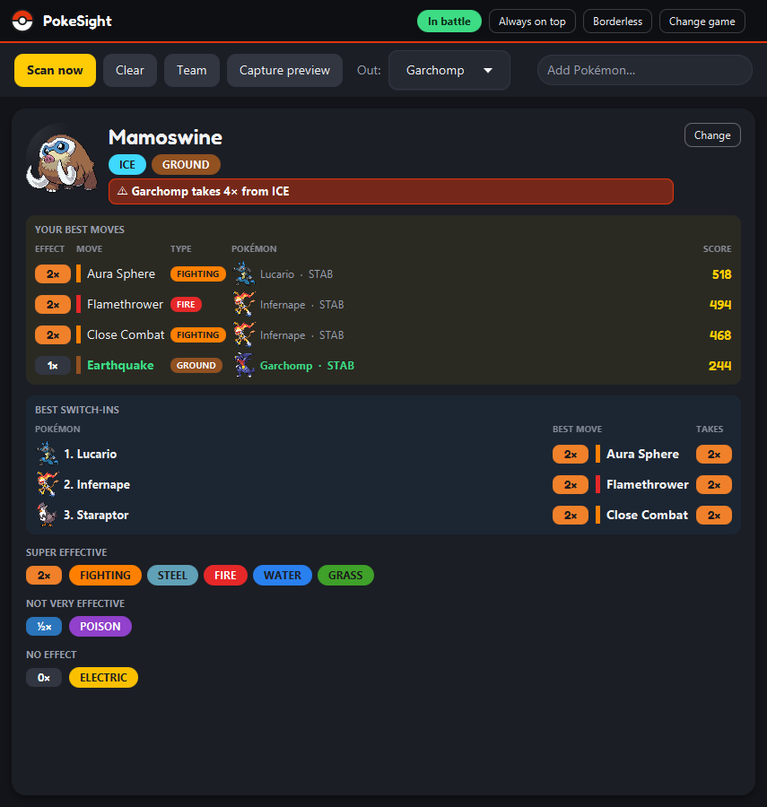
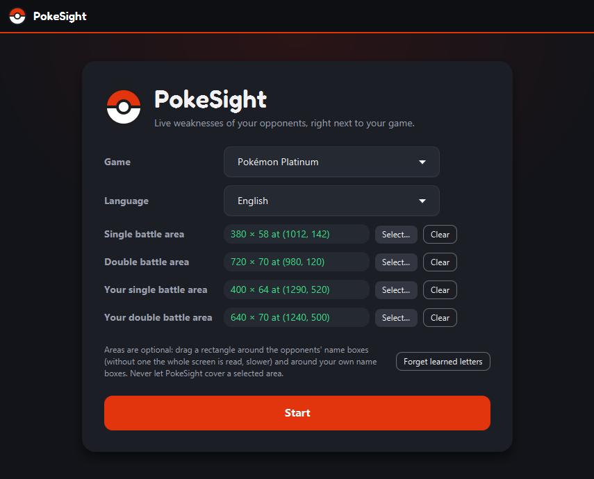
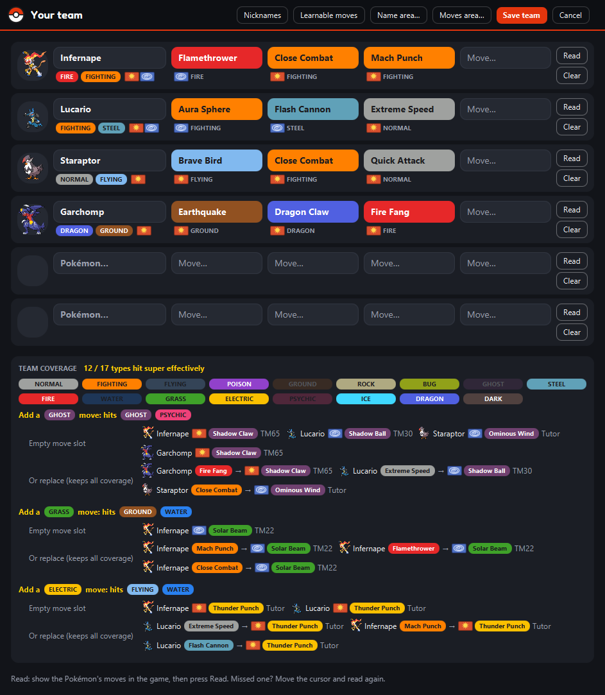

# PokeSight

> **About this project and AI:** PokeSight was coded entirely by an AI coding assistant (Claude Code); I directed it,
> tested the app and decided what to build. I did this on purpose, to see how a fully AI-coded app compares with an
> app I develop myself from scratch. **Result:** for a simple app like this it works surprisingly well, and it was
> surprisingly fast.

PokeSight is a second-screen companion for Pokémon games. It reads the opponents' names from the screen, detects when a
battle starts and shows each opponent's weaknesses, resistances and immunities, your best moves against it and which
of your Pokémon to switch in. It only looks at the screen: no emulator plugin, no memory access.

| Single battle | Double battle |
|---|---|
|  |  |
| **Start screen** | **Team editor** |
|  |  |

## Features

| Feature | What you get |
|---|---|
| Battle detection | Single, double and triple battles and hordes; **Scan now** if one was missed |
| Matchups | Weaknesses, resistances and immunities by the rules of the game's generation |
| Your best moves | The strongest moves of your team per opponent; your Pokémon on the field in green, its best move in bold |
| Best switch-ins | Your top 3 Pokémon against the opponent: damage dealt for damage taken |
| Danger warning | "⚠ Kirlia takes 4× from ICE" under the opponent's types when it counters your Pokémon on the field |
| Team editor | Moves in their type colours, a physical/special icon per Pokémon, team coverage with the moves your Pokémon can learn; **Read** fills in a Pokémon and its moves from the game |
| Who is out | Read from your own name boxes, or picked by hand; evolved team members are updated |
| Catch star | ★ marks Pokémon worth catching ([Catch star](#catch-star)) |
| Corrections | **Change** a misread Pokémon or its form, **Add Pokémon…** by name, **Tera…** in Scarlet/Violet |
| Borderless mode | Only the cards, in a small window over a part of the emulator |

Regional forms are shown in their region's games (Alolan Meowth in Sun/Moon). Dark theme, English and German names.

**Supported:** all main-series games from Red/Blue to Legends: Z-A, English and German, on Windows, each with the rules
of its own generation (remakes have their own: FireRed/LeafGreen uses Gen 3). Plus [ROM hacks](#supported-rom-hacks)
and [custom games](#custom-games).

### Name reading

Checked on 254 real battle screenshots (at least five per game) at emulator window sizes 1×, 2× (smoothed) and 3×.
Correctly read views on the first scan:

| Game | Ruleset | Read | | Game | Ruleset | Read |
|---|---|---|---|---|---|---|
| Red / Blue | gen1 | 36 / 42 | | Black / White | gen5 | 38 / 54 |
| Yellow | gen1 | 32 / 33 | | Black 2 / White 2 | gen5 | 30 / 45 |
| Gold / Silver | gen2 | 28 / 33 | | X / Y | gen6 | 28 / 48 |
| Crystal | gen2 | 34 / 36 | | Omega Ruby / Alpha Sapphire | gen6 | 29 / 42 |
| Ruby / Sapphire | gen3 | 37 / 39 | | Sun / Moon | gen7 | 26 / 27 |
| Emerald | gen3 | 36 / 39 | | Ultra Sun / Ultra Moon | gen7 | 20 / 24 |
| FireRed / LeafGreen | gen3 | 26 / 27 | | Let's Go, Pikachu! / Eevee! | lets-go | 7 / 8 |
| Diamond / Pearl | gen4 | 38 / 39 | | Sword / Shield | gen8 | 10 / 10 |
| Platinum | gen4 | 42 / 42 | | Brilliant Diamond / Shining Pearl | gen8 | 6 / 6 |
| HeartGold / SoulSilver | gen4 | 33 / 33 | | Legends: Arceus | gen8 | 9 / 9 |
| | | | | Scarlet / Violet | gen9 | 14 / 15 |
| | | | | Legends: Z-A | gen9 | 5 / 5 |

Total 564 of 656 views (86 %); with the letter shapes PokeSight learns while you play
([How it works](#how-it-works)) 586 (89 %). A missed view is usually one scan: a battle starts when two of the last
three scans agree. The Game Boy, GBA and DS games read best; the narrow outlined fonts of Black/White and X/Y worst.
In Legends: Arceus, Scarlet/Violet and Legends: Z-A the name floating in the 3D scene is found by its HP bar (not once
the bar is empty). If a game reads badly for you, a screenshot of your emulator window in battle helps improve it.

> PokeSight is a fan project. It is not affiliated with, endorsed or sponsored by Nintendo, Game Freak, Creatures or
> The Pokémon Company. Pokémon and all related names are trademarks of their respective owners.

## Supported ROM hacks

Listed below the official games with a "ROM hack" badge; English only. Rules come from each hack's own data.

| Hack | Base | Rules and sprites | Names read |
|---|---|---|---|
| [Heartfelt Gold](https://pokehackdex.com/romhacks/pokemon-heartfelt-gold/) | HeartGold, hg-engine | All generations, Gen 9 type chart, the hack's moves and names; own sprites | 6 / 6 |
| [Odyssey](https://eeveeexpo.com/odyssey/) | FireRed | Aether type instead of Fairy, Etrian Variants, new Pokémon (no sprite) and moves, from the developer's data | 8 / 9 |
| [R.O.W.E.](https://www.hackdex.app/hack/pokemon-rowe) | Emerald, pokeemerald | All 1025 Pokémon, the hack's types (Poison/Dark Arbok), stats and moves (default options); own sprites | 7 / 9 |
| [Unbound](https://pokefirered.com/pokemon-unbound/) | FireRed, CFRU + DPE | Up to Gen 8, the hack's stats, move powers and moves; own sprites | 12 / 12 |
| [Glazed](https://www.gamebrew.org/wiki/Pokemon_Glazed_GBA) | Emerald, v9.1 | Gen 1-6 in Emerald's 411 slots, Gen 7 stats and moves, Megas as own slots; built from changelog and fan wiki (no source) | 14 / 15 |
| [Emerald Rogue](https://www.hackdex.app/hack/emerald-rogue) | Emerald, pokeemerald-expansion | EX edition v2.1: all 1025 Pokémon, Gen 9 defaults, in-game names; own sprites. Vanilla edition: choose Emerald | 8 / 12 |
| [Lazarus](https://pokemonlazarus.net/) | Emerald, pokeemerald-expansion | v2.0: the expansion's Gen 9 defaults (no source; documented changes affect no matchup) | 3 / 10 (only a 1.5× collage) |

## Custom games

**[Pokémon Platinum Together](https://platinumtogether.online/)** (multiplayer mod of Platinum, "Custom" badge,
English): the start screen has a switch for the world rule **MODERN POKéMON**, remembered in `settings.yaml`.

| MODERN POKéMON | Rules |
|---|---|
| OFF (default) | Platinum's 493 Pokémon, types, moves and type chart |
| ON | Plus Gen 5-9 Pokémon, the Fairy type, the Gen 6+ type chart and the newer games' types and moves (Ralts is Psychic/Fairy) |

The other world rules change no type. Base stats of the original 493 are Platinum's. Sprites are PokeAPI's defaults.

## Getting started

| Option | How |
|---|---|
| Download (no Java needed) | `PokeSight-<version>-windows.zip` from [Releases](../../releases), unzip, start `PokeSight\PokeSight.exe` |
| From source | JDK 25 (`winget install EclipseAdoptium.Temurin.25.JDK`), clone to a Windows folder (not WSL), `gradlew.bat run` |
| Own exe | `gradlew.bat installLocal` (installs with shortcuts), `portableZip` or `jpackageImage` |

The first battle downloads the game's sprites (0.5-2 MB) from [PokeAPI/sprites](https://github.com/PokeAPI/sprites);
offline the cards show none. The first build downloads the OCR models and test screenshots.

## Using PokeSight

1. Start the game and PokeSight next to it (a second monitor works best).
2. On the start screen pick the game and its language.
3. Optionally select the screen areas with the name boxes. PokeSight reads what is visible, so never cover them with its
   window. Without an opponent area the whole main screen is read: slower, and other windows may be picked up.

   | Area | What to select |
   |---|---|
   | Single battle | the opponent's name box |
   | Double battle | both opponents' name boxes |
   | Your single battle | your own name box: which of your team is out |
   | Your double battle | both of your own name boxes |

4. Press **Start**. **Capture preview** shows what the scan sees.

| Control | Purpose |
|---|---|
| automatic | A battle starts when two of the last three scans (every 0.7 s) agree; it ends after about 4 s without a name |
| **Scan now** | Read the screen now |
| **Team** | Your team: up to six Pokémon with four moves each |
| **Change** (card) | Pick the right Pokémon or form (Sandy Wormadam) |
| **Tera…** (card) | Scarlet/Violet: the opponent's Tera type |
| **Out:** | Your Pokémon on the field; read from your own areas or picked here (a second one in double battles) |
| **Add Pokémon…** / **Clear** | Add an opponent by hand / forget the battle |
| **Always on top** | Keep the window above the emulator |
| **Borderless** | Only the cards, two opponents side by side; hover for the buttons, Esc exits, drag to move |

The window remembers its size and position (default 855 × 640).

### Team editor

| Part | Meaning |
|---|---|
| Move fields | Filled in the move's type colour, type and category below |
| Burst / rings beside a Pokémon's types | Physical / special moves hit harder for it (both: about equal); hover or click for Attack vs Sp. Atk. Its move suggestions list that kind first. |
| Team coverage | All types; faded ones no move of yours hits super effectively (hover a type for the moves that do) |
| Add a … move | The move type that hits most faded types, and where it could go: team members with an empty move slot, or moves you can replace without losing any super-effective coverage (else those that lose the least, with what they lose). Each place names the move that member learns and how (**Earthquake TM26**); only members that learn one are named, faded if none does. Click the type to list them all |
| **Learnable moves** | The game's learnsets as a searchable list: damaging moves, power and how they are learned (level, TM/HM/TR, tutor, egg). Your team or every Pokémon; search by move, type, Pokémon or TM (`ground infernape`, `tm26`). Official games only; Platinum Together's MODERN POKéMON learn what they learn in the newest game that has them (*italic*) |
| **Nicknames** | Shows a nickname field per Pokémon. A nicknamed Pokémon's name box shows the nickname: enter it so PokeSight knows it is out (and **Read** knows it) |

**Reading your team:** press **Moves area…** once per game and drag around the move names of the game's move selection
or summary; optionally **Name area…** around the Pokémon's name on the same screen. Then show a Pokémon's moves in the
game and press **Read** in a row. The move under the cursor is often missed: move the cursor and read again. Status
moves are skipped. Nicknamed Pokémon cannot be matched: pick them by hand, **Read** still fills in their moves.

**Evolution:** when your single-battle name box shows a later stage of exactly one team member (Monferno for
Chimchar), that member evolves and keeps its moves. Change it back by hand in the team editor and it stays that way
(saved as `declinedEvolutions`). A nicknamed Pokémon is recognized by its nickname, so its evolution is not
detected: change it in the team editor.

### How the advice is scored

Base stats only: levels, natures, EVs, abilities and the opponent's real moves are not known.

| Advice | Score |
|---|---|
| Your best moves | Power × type effectiveness × 1.5 for STAB × your Attack / its Defense (Sp. Atk / Sp. Def for special moves; until Gen 3 the move's type decides) |
| Best switch-ins | Damage dealt (best move score) for damage taken (worst of its types as STAB moves against yours, × its attack / your defense; immunity counts as ¼×) |
| Danger warning | Your Pokémon on the field takes 2× or more from the opponent's types; 4× (likely a one-hit knock-out) in stronger red |

### Catch star

A ★ next to an opponent's name means it is worth catching; hover it for the reason. Earlier stages get the star of
their evolution (Magikarp gets Gyarados's); an entry for one evolution path stars only that path.

| Rule | Which Pokémon |
|---|---|
| Always | Legendary and mythical Pokémon, Ultra Beasts, Paradox Pokémon |
| Games with a Smogon in-game tier list | The top tiers (S and A; High in older lists), rated for a playthrough |
| Other games, and Pokémon newer than the list | The 5 strongest final evolutions of each type by base stat total |

| Tier list | Games |
|---|---|
| [Smogon guides](https://www.smogon.com/ingame/guides/) | Red/Blue/Yellow, Ruby/Sapphire/Emerald, FireRed/LeafGreen, Diamond/Pearl, Platinum (also Platinum Together), HeartGold/SoulSilver, Black/White |
| Smogon forum lists (S and A transcribed) | Gold/Silver/Crystal, Black 2/White 2, Omega Ruby/Alpha Sapphire, Sun/Moon, Ultra Sun/Ultra Moon, Brilliant Diamond/Shining Pearl |
| none (base stats) | X/Y, Let's Go, Sword/Shield, Legends: Arceus, Scarlet/Violet, Legends: Z-A, all ROM hacks |

Version exclusives count only in their version; Pokémon a list leaves out get no star.

## Settings

Plain YAML in `%APPDATA%\PokeSight`; edit only while PokeSight is closed, delete the folder to reset. An unreadable
file is ignored. Caches in `%LOCALAPPDATA%\PokeSight`: `sprites\` and the learned letter shapes `glyphs\<game id>.txt`
(**Forget learned letters** on the start screen deletes them, e.g. after changing the emulator's window size).

On start PokeSight asks GitHub once for a newer version (anonymous) and offers a **Download** button;
`updateCheck: false` in `settings.yaml` turns this off.

```
%APPDATA%\PokeSight\
├─ settings.yaml          last game and language, window, updateCheck, gameOptions (MODERN POKéMON)
└─ games\<game id>.yaml   screen areas and your team for that game
```

```yaml
# games/<game id>.yaml
singleArea: { x: 2, "y": 210, width: 757, height: 211 }   # screen pixels; null = not selected
doubleArea: { x: 1, "y": 104, width: 1099, height: 418 }
ownArea: { x: 520, "y": 330, width: 400, height: 90 }
ownDoubleArea: { x: 500, "y": 300, width: 600, height: 180 }
movesArea: { x: 40, "y": 520, width: 600, height: 160 }   # team editor: move selection
nameArea: { x: 40, "y": 80, width: 260, height: 50 }     # team editor: the Pokémon's name
team:
  - { pokemon: 4, form: 0, moves: [52, 10], nickname: Blaze } # national dex number, form index, move ids, nickname (optional)
```

## How it works

Every 0.7 s PokeSight captures the selected areas and reads them with [Tesseract](https://github.com/tesseract-ocr/tesseract)
OCR. Each image is prepared first: only pixels near the text colour are kept (dark and light text; light text must be
uncoloured, so sky and water drop out), box borders and HP bars are removed and the letters are scaled up. The text is
matched against the game's names with an edit distance in which look-alike letters (G/S, O/D/C, U/V/W) count half.
Your own name boxes are matched against your team only, which allows more misread letters.

Tesseract misreads some pixel fonts consistently, so PokeSight also learns your game's font on your screen: the letter
shapes of every recognized name are stored, and each image is also read by comparing shapes. Both readings vote. The
shapes stay on your computer.

## Development

```
src/main/java/de/alorbach/pokesight/
├─ PokeSightApp.java     entry point
├─ game/                 game definitions (games/*.yaml)
├─ sprite/               sprite download and cache
├─ ruleset/              types, type chart, species, forms, moves, learnsets
├─ capture/              screenshots of screen regions
├─ ocr/                  Tesseract adapter, image preparation, learned letters, HP bar search
├─ battle/               name matching, battle scanning, auto-detection, move reading
├─ matchup/              weaknesses, move ranking, switch-ins, coverage, attack style
├─ catching/             catch star
├─ settings/             settings files
├─ update/               update check
└─ ui/                   JavaFX views
src/main/resources/      games/*.yaml, rulesets/<id>/, learnsets/<id>.yaml and catch data (generated), ui/
tools/                   ruleset, learnset, catch data and icon generators
packaging/               icon, install.ps1
.github/workflows/       release.yml: builds the portable zip for every pushed v* tag
```

| Pattern | Where | Why |
|---|---|---|
| Adapter | `TextRecognizer` / `TesseractTextRecognizer` | Swap the OCR engine without touching the battle logic |
| Adapter | `ScreenSource` / `RobotScreenSource` | Fake screenshots in tests |
| Observer | `BattleMonitor` → `BattleView` | Background scanning pushes changes to the UI |
| View model | `BattleBoard` | Corrections and additions, testable without JavaFX |

| Task | How |
|---|---|
| Tests | `gradlew.bat test` (fast), `ocrTest` (real screenshots, minutes), `check` (both) |
| Release | Push an annotated tag `vX.Y.Z`; CI runs the tests and attaches the zip to a release titled with the tag message's first line |
| Add a game | `games/<id>.yaml` (copy one of the same generation), listed in `games/index.yaml`. Keys: `region`, `floatingNames`, `yellowNames` (Platinum Together's turn indicator), `terastal`, `options`, `tierList`, `learnsets` |
| Regenerate a ruleset | `java tools/GenerateRuleset.java <PokeAPI version group> src/main/resources/rulesets/<id>`: the data as it was in that generation |
| Regenerate learnsets | `java tools/GenerateLearnsets.java src/main/resources/learnsets`: one file per official game (PokeAPI version group), damaging moves only |
| ROM hack rulesets | `GenerateHgEngineRuleset`, `GenerateOdysseyRuleset`, `GeneratePokeemeraldRuleset`, `GenerateCfruRuleset`, `GenerateGlazedRuleset`, `GenerateLazarusRuleset` in `tools/`; exact commands in their Javadoc |
| Catch data | `java tools/GenerateCatchData.java src/main/resources`: evolutions and legendary flags from PokeAPI, tier lists from Smogon; every entry checked against PokeAPI |

| Ruleset | Version group | | Ruleset | Version group |
|---|---|---|---|---|
| gen1 | yellow | | gen6 | omega-ruby-alpha-sapphire |
| gen2 | crystal | | gen7 | ultra-sun-ultra-moon |
| gen3 | firered-leafgreen | | lets-go | lets-go-pikachu-lets-go-eevee |
| gen4 | heartgold-soulsilver | | gen8 | legends-arceus |
| gen5 | black-2-white-2 | | gen9 | the-indigo-disk |

**OCR tests:** `src/test/resources/screenshots.tsv` lists the battle screenshots (URL, SHA-256, game, language,
opponents); the build downloads them. `GameScreenshotOcrTest` fails when a game reads fewer views than its recorded
minimum, with Tesseract alone and with learned letters. The official games' minimums may only rise. All OCR tests are
tagged `ocr`.

**Data checked** against Pokémon Showdown's per-generation data for every ruleset: type chart, types and base stats of
all species and forms, power, type and category of all moves.

## Known limitations

- Windows only.
- Only names are read, not levels or HP; an unreadable name box is skipped (use **Add Pokémon…**).
- Alternate forms (Wormadam cloaks, Arceus plates) show as the base or regional form; use **Change**.
- Mega Evolution and Dynamax are not shown; Tera types are set by hand.
- Matchups go by types alone: no abilities, held items or weather.
- Each game knows every Pokémon up to its generation, also uncatchable ones.
- Legends: Arceus and Legends: Z-A moves are ranked with Gen 8 / Gen 9 power.
- Type changes during battle (Forecast, Color Change) are not tracked.
- Monitors with different display scaling can shift the selected areas.

## Licenses and credits

PokeSight's own code is released under the [MIT License](LICENSE). The app bundles third-party software under its own
licenses: see [THIRD-PARTY-NOTICES.md](THIRD-PARTY-NOTICES.md) and the [licenses](licenses) folder, both also in the
app folder.

The release contains no Pokémon images: the app downloads the sprites, the build downloads the test screenshots. Only
the README screenshots in `docs/screenshots` show sprites. None of these are covered by the MIT License:

| What | Source | License / owner |
|---|---|---|
| Sprites | [PokeAPI/sprites](https://github.com/PokeAPI/sprites), pinned commit (URLs in `games/*.yaml`) | © Nintendo / Game Freak / The Pokémon Company |
| Sprites in the README screenshots | `docs/screenshots`, sprites from [PokeAPI/sprites](https://github.com/PokeAPI/sprites) | © Nintendo / Game Freak / The Pokémon Company |
| Test screenshots | Bulbagarden Archives, Wikipedia, PokéWiki (URLs in `src/test/resources/screenshots.tsv`) | © Nintendo / Game Freak / The Pokémon Company |
| Paldean Tauros / Wooper German names | [PokéWiki](https://www.pokewiki.de) (missing in PokeAPI) | names © Nintendo / Game Freak / The Pokémon Company |
| Pokémon data (names, types, base stats, moves, evolutions, legendary/mythical) | [PokeAPI](https://pokeapi.co), cross-checked with [Pokémon Showdown](https://github.com/smogon/pokemon-showdown) | game data © Nintendo / Game Freak / The Pokémon Company |
| Learnsets (which moves a Pokémon learns, TM numbers) | [PokeAPI](https://pokeapi.co) | game data © Nintendo / Game Freak / The Pokémon Company |
| Catch star tier lists | Smogon in-game tier lists: [RBY](https://www.smogon.com/ingame/guides/rby_ingametiers) (DrumstickGaming, Ryota Mitarai and others), [RSE](https://www.smogon.com/ingame/guides/adv_rse_ingametiers) (Fireburn), [FRLG](https://www.smogon.com/ingame/guides/adv_frlg_ingametiers) (Ryota Mitarai, Kurona, DrumstickGaming, Zebes and others), [DP](https://www.smogon.com/ingame/guides/dpp_ingametiers) and [Platinum](https://www.smogon.com/ingame/guides/dpp_plat_ingametiers) (Jubilee), [HGSS](https://www.smogon.com/ingame/guides/hgss_ingame_tier) (Turdterra, ceal, DrumstickGaming, Ryota Mitarai and others), [BW](https://www.smogon.com/ingame/guides/bw_ingametiers) (DrumstickGaming, Ryota Mitarai, Xator Nova and others); forum lists [GSC](https://www.smogon.com/forums/threads/gsc-in-game-tier-list-mark-v.3687563/) (Turdterra), [B2W2](https://www.smogon.com/forums/threads/pokemon-black-2-and-white-2-in-game-tier-list-reboot.3705068/) (ceal), [ORAS](https://www.smogon.com/forums/threads/oras-tier-list-v2-0.3532211/) and [Sun/Moon](https://www.smogon.com/forums/threads/sun-moon-in-game-tier-list.3587886/) (Colonel M), [USUM](https://www.smogon.com/forums/threads/pokemon-ultra-sun-and-ultra-moon-in-game-tier-list-v2.3676552/) (Ryota Mitarai), [BDSP](https://www.smogon.com/forums/threads/pok%C3%A9mon-brilliant-diamond-and-shining-pearl-in-game-tier-list.3724116/) (MeepBard) | tier placements by the Smogon contributors named; only the tiers and entry names are used |
| Ultra Beasts, Paradox Pokémon | [Bulbapedia](https://bulbapedia.bulbagarden.net/wiki/Ultra_Beast) / [Paradox Pokémon](https://bulbapedia.bulbagarden.net/wiki/Paradox_Pok%C3%A9mon) lists | reference |
| OCR engine | [Tesseract](https://github.com/tesseract-ocr/tesseract) via [JavaCPP Presets](https://github.com/bytedeco/javacpp-presets) | Apache 2.0 |
| OCR models | [tessdata_fast](https://github.com/tesseract-ocr/tessdata_fast) 4.1.0 | Apache 2.0 |
| UI | [OpenJFX](https://openjfx.io) | GPL 2.0 with Classpath Exception |
| YAML | [Jackson](https://github.com/FasterXML/jackson) | Apache 2.0 |
| Display font | [Fredoka](https://fonts.google.com/specimen/Fredoka) (bundled, `src/main/resources/ui/fonts`) | SIL Open Font License 1.1 |
| Type colours | Scarlet/Violet palette from [WikiDex](https://www.wikidex.net/wiki/Ayuda:Paleta_de_colores) | colour values |
| Gen 4 Arceus form order | [PKHeX](https://github.com/kwsch/PKHeX) `FormItem.GetFormArceusPlate` | reference |
