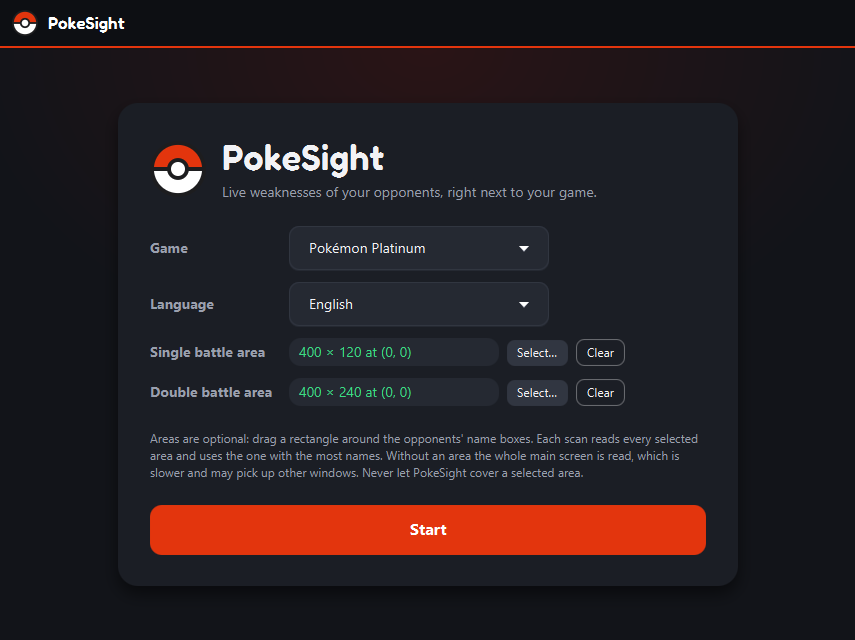
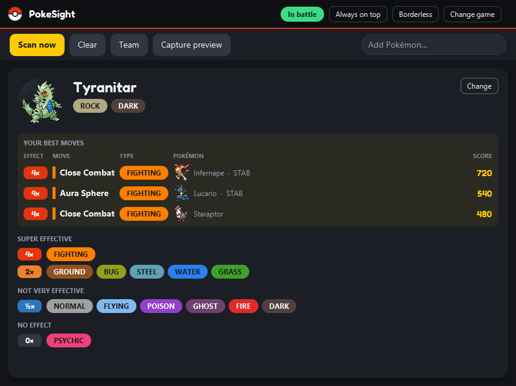
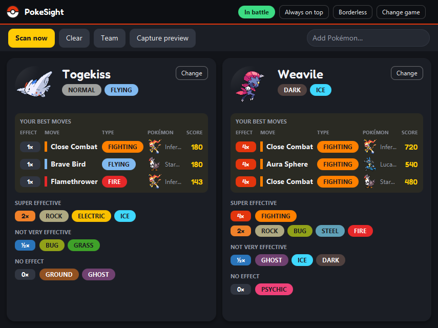

# PokeSight

> **About this project and AI:** PokeSight was coded entirely by an AI coding assistant (Claude Code); I directed it,
> tested the app and decided what to build. I did this on purpose, to see how a fully AI-coded app compares with an
> app I develop myself from scratch. **Result:** for a simple app like this it works surprisingly well, and it was
> surprisingly fast.

PokeSight is a second-screen companion for Pokémon games. It reads the opponents' names from the screen, detects
when a battle starts and shows each opponent's weaknesses, resistances and immunities, plus which moves of your team
hit it hardest. It only looks at the screen, so it needs no emulator plugin or memory access.



| Single battle | Double battle |
|---|---|
|  |  |

- Single, double and triple battles and hordes, auto-detection plus **Scan now** if a battle was missed
- Correct a misread Pokémon or add one by hand with a name search
- **Your best moves**: enter your team once (or let PokeSight read the moves from the game), see the strongest move
  per opponent; moves are marked with their type colour
- **Borderless mode**: only the cards, filling a small window you can put over a part of the emulator
- Regional forms: in Sun/Moon a wild Meowth is shown as Alolan Meowth, in Sword/Shield as Galarian Meowth, etc.
- Dark theme, original sprites, English and German game names

**Supported:** all main-series games from Red/Blue to Legends: Z-A, English and German, on Windows. Every game uses
the rules of its own generation (type chart, types, move power); remakes are separate games with their own rules and
screens, e.g. Red/Blue (Gen 1, Game Boy font) and FireRed/LeafGreen (Gen 3, GBA font).

The name reading is checked on 254 real battle screenshots, at least five per game, at emulator window sizes 1×, 2×
(smoothed) and 3× (Full HD screenshots of the Switch games at their size). Correctly read views:

| Game | Ruleset | Read | | Game | Ruleset | Read |
|---|---|---|---|---|---|---|
| Red / Blue | gen1 | 36 / 42 | | Black / White | gen5 | 37 / 54 |
| Yellow | gen1 | 32 / 33 | | Black 2 / White 2 | gen5 | 30 / 45 |
| Gold / Silver | gen2 | 28 / 33 | | X / Y | gen6 | 28 / 48 |
| Crystal | gen2 | 34 / 36 | | Omega Ruby / Alpha Sapphire | gen6 | 29 / 42 |
| Ruby / Sapphire | gen3 | 37 / 39 | | Sun / Moon | gen7 | 26 / 27 |
| Emerald | gen3 | 36 / 39 | | Ultra Sun / Ultra Moon | gen7 | 20 / 24 |
| FireRed / LeafGreen | gen3 | 26 / 27 | | Let's Go, Pikachu! / Eevee! | lets-go | 7 / 8 |
| Diamond / Pearl | gen4 | 38 / 39 | | Sword / Shield | gen8 | 10 / 10 |
| Platinum | gen4 | 42 / 42 | | Brilliant Diamond / Shining Pearl | gen8 | 6 / 6 |
| HeartGold / SoulSilver | gen4 | 33 / 33 | | Legends: Arceus | gen8 | 9 / 9 |
| | | | | Scarlet / Violet | gen9 | 14 / 15 |
| | | | | Legends: Z-A | gen9 | 5 / 5 |

That is 563 of 656 views (86 %) on the very first scan. PokeSight also learns the letter shapes of your game while
you play (see [How it works](#how-it-works)); learned from the other screenshots of the same game, it reads 582 of 656
views (89 %), most of all in the Game Boy games (Red/Blue 41 / 42, Crystal 36 / 36) and Ultra Sun / Ultra Moon
(23 / 24). A missed view is usually a single scan: PokeSight scans every 0.7 s and a battle
starts as soon as two of the last three scans agree, so it is still detected as long as most scans read the name. The Game Boy, GBA and DS games work best. In Black/White and X/Y the narrow, outlined fonts are
read less reliably. In Legends: Arceus, Scarlet/Violet and Legends: Z-A the name floats above the opponent in the 3D
scene and is found by its HP bar, also when the bar is almost empty; only a fainted opponent's empty bar is not found.
Text of the scene is only taken for a name if it stands right over the bar. If a game works badly for you, a
screenshot of your emulator window during a battle helps to improve it.

> PokeSight is a fan project. It is not affiliated with, endorsed or sponsored by Nintendo, Game Freak, Creatures or
> The Pokémon Company. Pokémon and all related names are trademarks of their respective owners.

## Getting started

### Option 1: Download a release (no Java needed)

1. Download `PokeSight-<version>-windows.zip` from the [Releases](../../releases) page.
2. Unzip it anywhere and start `PokeSight\PokeSight.exe`.

The first battle view downloads the sprites of the selected game (0.5–2 MB) from
[PokeAPI/sprites](https://github.com/PokeAPI/sprites); until then, or offline, the cards show no sprite.

### Option 2: Run from source

Requirements: Windows and a JDK 25 (for example `winget install EclipseAdoptium.Temurin.25.JDK`). Clone the repository
to a Windows folder (not inside WSL: the app captures the Windows desktop), then:

```
gradlew.bat run
```

or run the Gradle task `run` (group *application*).

The first build downloads the OCR models and the test screenshots (see [Licenses](#licenses-and-credits)).

### Option 3: Build your own exe

| Gradle task (group *distribution*) | Result |
|---|---|
| `gradlew.bat installLocal` | Installs for the current user to `%LOCALAPPDATA%\Programs\PokeSight` with desktop and Start menu shortcuts |
| `gradlew.bat portableZip` | `build/distributions/PokeSight-<version>-windows.zip`: unzip anywhere and start `PokeSight.exe` |
| `gradlew.bat jpackageImage` | Just the app folder `build/jpackage/PokeSight` (`PokeSight.exe` + Java runtime) |

## Using PokeSight

1. Start the game in your emulator and PokeSight next to it (a second monitor works best).
2. On the start screen pick the game and its language.
3. Optionally select the **screen areas** where the opponents' name boxes appear:

   | Setting | What to select |
   |---|---|
   | Single battle area | the opponent's name box in a single battle |
   | Double battle area | the part with both opponents' name boxes in a double battle |

   Each scan reads every selected area and uses the one that recognizes the most names. Without any area the whole
   main screen is read: slower, and it may pick up other windows. PokeSight reads what is visible on screen, including
   its own window, so never let it cover a selected area. With melonDS's hybrid layout, select the name boxes on the
   large screen; PokeSight can cover the small copy of the top screen.
4. Press **Start**. Use **Capture preview** to check what the scan sees.

| Control | Purpose |
|---|---|
| automatic | A battle starts when the same names are read in two of the last three scans (every 0.7 s); it ends after about 4 s without any name |
| **Scan now** | Reads the screen immediately, even if auto-detection did not trigger |
| **Team** | Your team: up to six Pokémon with up to four moves each; **Read** fills a Pokémon's moves from the game (see below) |
| **Change** (on a card) | Search for the correct Pokémon if a name was misread; also for alternate forms like Sandy Wormadam |
| **Add Pokémon…** | Add an opponent by hand |
| **Clear** | Forget the current battle, corrections and additions |
| **Capture preview** | Shows (and saves) the last captured images |
| **Always on top** | Keeps the window above the emulator |
| **Borderless** | Only the cards remain and fill the window: one opponent the whole window, two opponents the left and right half. Hovering shows a button bar (scan, clear, team, always on top, exit); Esc also exits; drag to move |

In a double battle the two opponents stand side by side (left and right), in the normal view and in borderless mode;
more opponents (triple battles, hordes) continue in rows of two. The default window size is 855 × 640, which every
view fills; PokeSight remembers the size and position you leave it at.

**Reading moves:** in the team editor, press **Moves area…** once per game and drag a rectangle around the move names
of the game's move selection (the fight menu or the summary's move list). Then open a Pokémon's move selection in the
game and press **Read** in its row: the damaging moves found fill the empty move fields. Status moves are skipped,
they do not take part in the ranking. The move under the cursor is drawn highlighted and often not read: move the
cursor and press **Read** again, moves already in the row are kept.

**Your best moves** ranks the team's moves per opponent by move power × type effectiveness × 1.5 if the move has its
Pokémon's type (STAB). Stats, level and abilities are not taken into account: it shows which move hits hardest by type
and power, not the exact damage.

## Settings

All settings are plain YAML files in `%APPDATA%\PokeSight`; nothing is written to the registry. Edit them only while
PokeSight is closed; a file that cannot be read is ignored and the defaults are used. Delete the folder to reset.
The sprites are a download cache in `%LOCALAPPDATA%\PokeSight\sprites`; they are downloaded again if deleted. The
letter shapes learned per game are in `%LOCALAPPDATA%\PokeSight\glyphs\<game id>.txt`; delete a file to relearn (for
example after changing the emulator's screen filter a lot).

```
%APPDATA%\PokeSight\
├─ settings.yaml          last game and language, window position, size and maximized state
└─ games\
   └─ <game id>.yaml      screen areas (singleArea, doubleArea, movesArea) and your team for that game
```

```yaml
# games/<game id>.yaml, e.g. games/red-blue.yaml
singleArea: { x: 2, "y": 210, width: 757, height: 211 }   # screen pixels; null = not selected
doubleArea: { x: 1, "y": 104, width: 1099, height: 418 }
movesArea: { x: 40, "y": 520, width: 600, height: 160 }   # the move selection, read by the team editor
team:
  - { pokemon: 4, form: 0, moves: [52, 10] }              # national dex number, form index, move ids
```

## How it works

Every 0.7 seconds PokeSight takes a screenshot of the selected areas and reads them with [Tesseract](https://github.com/tesseract-ocr/tesseract) OCR.
Game fonts are tiny pixel fonts with a drop shadow or an outline, so each image is prepared first: only the pixels
close to the text colour are kept (some games use white text on dark boxes, others dark text on light ones, so both
are tried; white text must also be uncoloured, which drops sky and water behind the 3DS and Switch name boxes), box
borders and HP bars are removed, the remaining letter-sized shapes are kept and scaled to about twice the DS size.
The text is then matched against the game's Pokémon names with a small edit distance in which letters OCR often mixes
up (G/S, O/D/C, U/V/W, ...) count half; name boxes standing side by side on one line (double battles since Gen 5) are
split at wide gaps. In games that write names in capitals (Gen 1–4), text in mixed case (code, chats, websites) is
ignored. In the games whose names float in the 3D scene, the solid HP bars are located first and only the labels
above them are read.

Tesseract misreads some pixel fonts consistently (Black/White "Ramoth" as "kanoth"), although the prepared letters are
clean. So PokeSight learns the font of your game on your screen: whenever a word is a name (at most one look-alike
letter off), the shapes of its letters are stored under that name's letters, and every image is also read by
comparing its letter shapes with the stored ones. Both readings vote. The shapes come from your own emulator window and
stay on your computer; nothing of the games ships with PokeSight. The tests are listed under
[Development](#development).

## Development

```
src/main/java/de/alorbach/pokesight/
├─ PokeSightApp.java     entry point, wires everything together
├─ game/                 game definitions (games/*.yaml): ruleset, languages, sprite URL
├─ sprite/               sprite download and cache in %LOCALAPPDATA%\PokeSight\sprites
├─ ruleset/              generation data: types, type chart, species, forms, moves
├─ capture/              screenshots of screen regions
├─ ocr/                  Tesseract adapter, image preparation, learned letter shapes, HP bar search
├─ battle/               name matching, battle scanning, auto-detection, move reading
├─ matchup/              weaknesses, team and move ranking
├─ settings/             settings files in %APPDATA%\PokeSight
└─ ui/                   JavaFX views (start screen, battle view, cards, team editor, title bar, theme)

src/main/resources/      games/*.yaml, rulesets/<id>/*.yaml (generated), ui/ (theme, font, icons)
packaging/               PokeSight.ico, install.ps1 (installLocal)
tools/                   GenerateRuleset.java (PokeAPI → YAML), GenerateIcon.java (app icon)
.github/workflows/       release.yml: builds the portable zip for every pushed v* tag
licenses/                license texts of the bundled third-party software (THIRD-PARTY-NOTICES.md)
```

| Pattern | Where | Why |
|---|---|---|
| Adapter | `TextRecognizer` / `TesseractTextRecognizer` | Swap the OCR engine without touching the battle logic |
| Adapter | `ScreenSource` / `RobotScreenSource` | Screenshots are faked in tests; another source can plug in later |
| Observer | `BattleMonitor` → `BattleView` | Background scanning pushes changes to the UI |
| View model | `BattleBoard` | Corrections and added Pokémon, testable without JavaFX |

- **Tests:** `gradlew.bat test`.
- **Release:** push an annotated tag such as `v1.0.0`; the workflow tests, builds the portable zip and attaches it to
  a release titled with the tag message's first line.
- **Add a game:** create `games/<id>.yaml` (copy an existing game of the same generation) and list `<id>` in
  `games/index.yaml`. `region` (alola, galar, hisui, paldea) makes recognized Pokémon show in their regional form,
  `floatingNames` reads the labels above HP bars instead of fixed name boxes.
- **OCR tests:** `src/test/resources/screenshots.tsv` lists the battle screenshots (URL, SHA-256, game, language and
  the opponents they show); the build downloads them. `GameScreenshotOcrTest` reads every one with its game's
  settings and fails when a game reads fewer views than the minimum recorded there, once with Tesseract alone and once
  with letter shapes learned from the game's other screenshots (it needs all of them; CI skips it, since one wiki
  blocks downloads from there); `ScreenshotOcrTest` checks Gen 4
  at every window size, `MoveReaderTest` the move reading.
- **Regenerate a ruleset:** `java tools/GenerateRuleset.java <PokeAPI version group> src/main/resources/rulesets/<id>`.
  It writes the type chart, the species with their alternate forms and the damaging moves, with types and move power
  as they were in that game (PokeAPI's change log is rolled back, e.g. Thunderbolt has 95 power in Gen 4):

  | Ruleset | Version group | | Ruleset | Version group |
  |---|---|---|---|---|
  | gen1 | yellow | | gen6 | omega-ruby-alpha-sapphire |
  | gen2 | crystal | | gen7 | ultra-sun-ultra-moon |
  | gen3 | firered-leafgreen | | lets-go | lets-go-pikachu-lets-go-eevee |
  | gen4 | heartgold-soulsilver | | gen8 | legends-arceus |
  | gen5 | black-2-white-2 | | gen9 | the-indigo-disk |
- **Data checked** against Pokémon Showdown's per-generation data (base data plus the gen1–gen8 and gen7letsgo mods)
  for every ruleset: type chart, types of all species and their alternate forms, power, type and category of all
  moves (until Gen 3 the category follows the type). Gaps in PokeAPI found that way are fixed in the generator.

## Known limitations

- Windows only (screen capture of the Windows desktop).
- Only names are read, not levels or HP. A name box whose name cannot be read is skipped; use **Add Pokémon…**.
- The battle screen only shows the species name, so alternate forms (Wormadam cloaks, Shaymin Sky, Arceus plates) are
  shown as the base form, or as the regional form in games of that region; use **Change** to pick the form.
- Battle-only changes are not shown: Mega Evolution, Dynamax/Gigantamax, Terastallization.
- Each game knows every Pokémon up to its generation, also those that cannot be caught in it (Sword/Shield, Let's Go).
- Legends: Arceus and Legends: Z-A have their own battle systems; their moves are ranked with the Gen 8 / Gen 9 power.
- Regional forms with the same types as the base form (e.g. Galarian Slowpoke) are shown with the base form's sprite;
  the matchup is the same.
- Type changes during battle (Castform's Forecast, Kecleon's Color Change) are not tracked.
- With display scaling, monitors with different scale factors can shift the selected areas.

## Licenses and credits

PokeSight's own code is released under the [MIT License](LICENSE): free to use, change and fork. The app bundles
third-party software under its own licenses: see [THIRD-PARTY-NOTICES.md](THIRD-PARTY-NOTICES.md) and the
[licenses](licenses) folder, both also included in the app folder.

The release contains no Pokémon images: the app downloads the sprites on first start, the build downloads the test
screenshots. The repository only contains the README screenshots in `docs/screenshots`, which show sprites. None of
these are covered by the MIT License:

| What | Source | License / owner |
|---|---|---|
| Sprites | [PokeAPI/sprites](https://github.com/PokeAPI/sprites), pinned commit (URLs in `games/*.yaml`) | © Nintendo / Game Freak / The Pokémon Company |
| Sprites in the README screenshots | `docs/screenshots`, sprites from [PokeAPI/sprites](https://github.com/PokeAPI/sprites) | © Nintendo / Game Freak / The Pokémon Company |
| Test screenshots | Bulbagarden Archives, Wikipedia, PokéWiki (URLs in `build.gradle.kts`) | © Nintendo / Game Freak / The Pokémon Company |
| Paldean Tauros / Wooper German names | [PokéWiki](https://www.pokewiki.de) (missing in PokeAPI) | names © Nintendo / Game Freak / The Pokémon Company |
| Pokémon data (names, types, moves) | [PokeAPI](https://pokeapi.co), cross-checked with [Pokémon Showdown](https://github.com/smogon/pokemon-showdown) | game data © Nintendo / Game Freak / The Pokémon Company |
| OCR engine | [Tesseract](https://github.com/tesseract-ocr/tesseract) via [JavaCPP Presets](https://github.com/bytedeco/javacpp-presets) | Apache 2.0 |
| OCR models | [tessdata_fast](https://github.com/tesseract-ocr/tessdata_fast) 4.1.0 | Apache 2.0 |
| UI | [OpenJFX](https://openjfx.io) | GPL 2.0 with Classpath Exception |
| YAML | [Jackson](https://github.com/FasterXML/jackson) | Apache 2.0 |
| Display font | [Fredoka](https://fonts.google.com/specimen/Fredoka) (bundled, `src/main/resources/ui/fonts`) | SIL Open Font License 1.1 |
| Type colours | Scarlet/Violet palette from [WikiDex](https://www.wikidex.net/wiki/Ayuda:Paleta_de_colores) | colour values |
| Gen 4 Arceus form order | [PKHeX](https://github.com/kwsch/PKHeX) `FormItem.GetFormArceusPlate` | reference |
